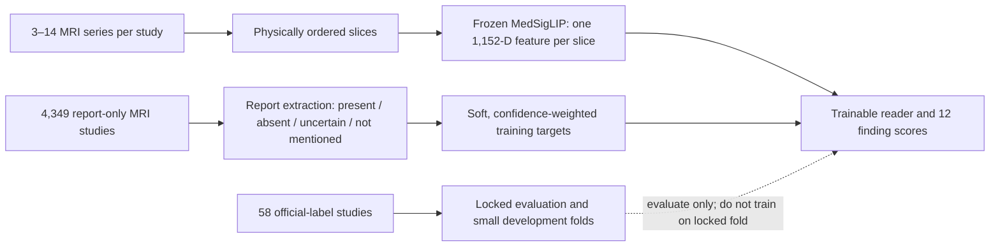

# RSNA Knee project: consolidated evidence and lessons

**Evidence reviewed through 25 September 2026.** This document brings together the local data audits, training runs, XAI analyses, the feature-design review from a teammate, the public Kaggle notebooks/discussion reviewed earlier, and the more recent spatial and representation tests. It distinguishes measured findings from working explanations. Public leaderboard scores, report-derived validation metrics, and official-label evaluation are different kinds of evidence and should not be compared as though they were one scale.

## What the task asks the model to learn

The model receives an MRI study made of multiple series. Each series is an ordered stack of slices from one plane and acquisition type. It must rank studies for twelve findings. The labels are not equally common: among the 58 studies with official labels, positive counts range from 9 for MCL to 35 for effusion. Those counts make per-finding estimates noisy, especially for MCL, lateral OA, and Baker’s cyst. A high or low AUC from one small split can move substantially when only a few studies change order.

| Finding | Official positives / 58 | Experiment 4 all-58 AUC |
|---|---:|---:|
| ACL | 24 | 0.797 |
| MCL | 9 | 0.678 |
| Medial meniscus | 26 | 0.648 |
| Lateral meniscus | 23 | 0.735 |
| Medial OA | 15 | 0.831 |
| Lateral OA | 11 | 0.754 |
| PF OA | 21 | 0.759 |
| Effusion | 35 | 0.917 |
| Synovitis | 27 | 0.674 |
| Baker’s cyst | 12 | 0.828 |
| Contusion | 19 | 0.742 |
| Fracture | 18 | 0.843 |

Experiment 4's macro AUC was 0.7596 on the 29-study development partition, 0.7685 on the separate 29-study evaluation partition, and 0.7672 across all 58. These values show useful image signal, but they do not establish precise per-target performance: each half has only 29 cases, and some targets have just four to seven positives there. The highest all-58 target result was effusion; meniscal findings, synovitis, and MCL were notably harder. The public leaderboard result of 0.801 from the first submission is an end-to-end benchmark, not a measured AUC for the reader alone.

The dataset contains 4,407 training studies, 24,371 series, and 819,078 slices. Only 58 studies have the official twelve labels; the remaining 4,349 are report-only. The target definitions are image-based and reports can disagree with them by design. Therefore the central learning problem is not “turn every report into a true label.” It is to exploit more image data without allowing uncertain or absent report statements to become false negatives.

The report model is a label generator used for training only. Report text is not an inference input. Across the report study-target pairs recorded in the run, the status counts were 13,096 present, 20,943 absent, 3,884 uncertain, and 14,229 not mentioned. The 34,039 present/absent cases are the resolved targets; not-mentioned and invalid targets have zero loss weight, while uncertainty is kept distinct and masked or down-weighted by the relevant experiment. These are counts of report-derived states, not official competition positives and negatives.

Qwen3-4B yielded usable, parser-validated soft labels for 4,068 of the 4,349 report-only studies; 281 had no usable target after evidence checks. This is a substantial training set, but its labels have not received a full clinical review. The extractor had to be repaired for repeated target keys, empty or placeholder quotes, multilingual matching, and statements that called a normal structure “present.” Those repairs reduce mechanical mistakes; they do not prove clinical correctness. Host clarifications explicitly warn that report/official-label disagreement is expected. This makes pseudo-label noise and target-specific calibration first-order concerns.

### What is known about image data and target relationships

- **The study is genuinely multi-view.** There are 9,864 sagittal, 8,609 coronal, and 5,898 axial series. A study has 3–14 series (median 5); a series has 11–320 slices (median 30). Different findings can plausibly depend on different planes, sequence types, and parts of a stack.
- **Sequence flags are partly redundant.** `Fluid_Sensitive` and `Fat_Suppression` are identical across all 24,371 listed series. The two names describe different concepts, but these data provide only one independent binary signal. Modeling them as independent learned inputs would duplicate the same dataset field.
- **DICOM free text is unreliable.** In the audited sample, `SeriesDescription` sometimes contained placeholders, `ProtocolName` was absent, and `SequenceName` was incomplete. Plane and the official fluid-sensitive flag are safer metadata than unreviewed descriptions.
- **Geometry is available and meaningful.** Physical slice ordering using DICOM orientation and position was visually checked in 106 series from 20 studies; the sampled stacks were continuous and ordered correctly. Across the cached series, median physical span was 102.3 mm, and adjacent-slice gaps had a 3.30 mm median with a wide range. Slice index alone therefore does not mean the same physical distance in every scan.
- **A true patient grouping key is not established.** `PatientID` was present but unique for all 4,407 studies, likely due to de-identification. It cannot establish that studies from the same real person are separated across folds. Duplicate report groups were handled in the report validation folds; pixel-level duplicates were not proven absent.
- **We have not established a complete label co-occurrence model.** We have target prevalence, per-target AUC, report-status counts, and disagreement analyses, but there is no vetted clinical correlation matrix showing which official findings co-occur or which combinations should constrain predictions. Any claim such as “ACL and meniscus labels should be coupled” remains a hypothesis until computed on a suitable reviewed set.

## What the image pipeline preserves—and what it discards

The first submission used frozen `google/medsiglip-448` features. The model emits one 1,152-dimensional vector per slice. The verified cache has 819,078 slice embeddings, stored in FP16, produced from physically ordered DICOM stacks. The encoder is not fine-tuned by the later reader experiments: gradients stop at the cached MedSigLIP features.

The feature contract matters. Each series is normalized using its own 1st/99th pixel percentiles, MONOCHROME1 is inverted, each image is square-padded and resized to 448, and the grayscale plane is repeated into three input channels. The knee crop is disabled. In-plane physical field of view is not normalized to a shared millimetre crop. Thus MedSigLIP sees a 2D image at a fixed pixel size, but the physical size represented by a pixel and the amount of padding can vary by acquisition. Once cached, information lost by this preprocessing cannot be recovered in the reader.

Experiment 4 does **not** compress a series into one generic token immediately. It projects every retained slice from 1,152 to a learned 256-dimensional state, adds normalized position and plane/fluid metadata, contextualizes slices within that series, then pools to one vector **per finding per series**. A second target-specific reader combines series; a masked global-mean branch also contributes to each finding. There are twelve outputs. The main irreversible reduction is still substantial: all slices within a series become one 256-dimensional vector for each target before study-level fusion. But the series contributes twelve target-conditioned vectors, not one shared vector.

The original reader uses normalized 0–1 series position, not absolute millimetres or inter-slice gaps. Training randomly retains at most 48 slices per series; evaluation retains at most 96 evenly spaced slices. One artifact was called “full slices,” but its recorded configuration still used the 48/96 caps. We therefore do not have a verified all-slice comparison, and cannot rule the cap in or out as a cause of the plateau. The model’s frozen image representation, intensity/FOV preparation, and the quality of its report supervision remain distinct possible limits.

The separate Pillar-0 path uses a volumetric foundation encoder and its own resampling/padding rules. It must not be conflated with the 2D MedSigLIP cache: prior experiments 1–8 trained on MedSigLIP embeddings, while the recent NaN/support-mask discussion concerns pixel-level volume preparation in the Pillar-0 path. The new support-aware audit is an inference/preprocessing test, not a training result. For the three selected report-only volumes, native pixels were finite; the low supported fraction in the fixed-size tensor (roughly 10–12%) mostly reflected deliberate spatial padding. Support-aware quantiles and resampling changed the resulting embedding only modestly (mean old/new cosine 0.9897 across those three examples). That is not a full-dataset estimate and says nothing yet about AUC. It does show why the support mask must distinguish a real zero-valued voxel from outside-volume padding. The latest Kaggle attempt stalled while pip tried to reach PyPI for `pydicom`; no model training or mask-effect evaluation was completed in that run.

## Experiment record: what changed and what it taught us

Metrics below are kept with their actual scope. BCE values are report-validation losses; gold AUC is computed on official labels; leaderboard scores are Kaggle public results. A one-fold screen is not the same strength of evidence as a five-fold comparison.

| Run / question | Result | What we can conclude |
|---|---|---|
| First MedSigLIP submission | Public score **0.801** | End-to-end pipeline works and is a credible baseline. It does not isolate the contribution of encoder, preprocessing, labels, or reader. |
| Experiment 2 confidence labels | Development macro AUC **0.7209 → 0.7316** in the reported comparison. On all 58 studies, Confidence V2 alone **0.7574**, Confidence V2 + linear **0.7836**, prior MIL + linear **0.7804**. | Confidence information and a simple linear readout were useful in that comparison. It did not establish a robust improvement across held-out folds. |
| Experiment 3 global fusion | Development **0.7794**, locked evaluation **0.7447**, all-58 **0.7618** | A promising development score did not carry over equally to the locked half. The split difference warns against model selection from one small development subset. |
| Experiment 4 target-specific MIL | Fold-0 report-validation BCE **0.566584**; all-58 macro AUC **0.7672** (development **0.7596**, evaluation **0.7685**). | Strongest stable single-reader reference in the early series. It already uses target-specific slice and series pooling plus a global branch. Its official-label signal is real but uneven by target. |
| Experiment 5 series dropout + consistency | Five-fold mean BCE **0.559708** vs Experiment 4 **0.557875**; worse on every fold. | Predictions became less sensitive to removed series, but classification did not improve. Robustness is not automatically useful if the removed series contains the finding’s clearest evidence. |
| Experiment 6 series dropout, no consistency | Five-fold mean BCE **0.558115** vs **0.557875**; 3/5 fold wins. | Effectively tied and slightly worse overall; not a reliable gain. |
| Experiment 7A generic cross-series set transformer | Fold 0 BCE **0.577727** with ranking; **0.573786** without ranking. | The ranking term lowered its own diagnostic loss but did not improve validation. Generic cross-series attention lost to Experiment 4. |
| Experiment 7B target-specific cross-series queries | Fold 0 BCE **0.573740** | Essentially the same as 7A without ranking and still worse than Experiment 4. Target-conditioned series reasoning alone did not fix the gap. |
| Experiment 7C slice-preserving target queries | Fold 0 BCE **0.571844**; training BCE kept falling while later validation BCE rose as high as **0.6374**. | Preserving slice tokens through target queries did not win in this implementation. This weakens “series compression is the only problem”; it does not prove slice-level evidence is unimportant. The train/validation gap is consistent with overfitting and noisy weak supervision. |
| Experiment 8 initial positional-bias attempts | Failed before producing valid learning metrics: import failures, then non-finite loss at epoch 0. | No valid evidence about relative-position bias. The code/config had a mask/attention numerical issue. Later physical-coordinate screens must be evaluated independently. |
| Experiment 9 six learned regional tokens | Fold 0 BCE **0.580975**; region centers inverted expected order in about **4.9%** of audited cases. | More regional summaries did not help this screen; learned “regions” are not guaranteed anatomical regions. |
| Experiment 13 noncompetitive slice-memory reader | Fold 0 BCE **0.567297** vs Experiment 4 **0.566583**. | Retaining multiple evidence slots was close but did not beat the simple reader. The tokens were highly similar (mean pairwise cosine 0.991) and their pooled weights nearly uniform. |
| Experiment 13 competitive routing | Fold 0 BCE **0.575638**; +0.008341 vs the matched noncompetitive reader (95% report-group bootstrap interval +0.000581 to +0.016531). | It made slots more distinct (token cosine 0.505) but harmed held-out loss on 8/12 findings. Diversity in representation alone is not predictive utility. |
| Experiment 16 reader draft | Best logged fold-0 BCE **0.5766** at epoch 24; analysis interrupted; no complete checkpoint/artifact. | Incomplete, not a validated result. |
| Physical-local context branch | Fold 0 BCE **0.568833** vs Experiment 4 **0.566584**. Zeroing its learned gate worsened its own BCE by **0.001989**, but the full reader’s gate was only **0.0281**. | Physical local context helped a little inside its own reader, but not enough to offset the whole-model regression. |
| Physical-window memory | Fold 0 BCE **0.575030** and report-label AUC proxy **0.8294** vs **0.8407** for Experiment 4. | Directly reading overlapping windows across series did worse. Attention could identify influential windows without those windows consistently helping the report target. |
| Three-volume support-mask audit | No training. Three volumes; old/new feature cosine mean **0.9897**. | The preprocessing correction is technically justified for correct support accounting, but improvement in representation or score is unproven. |

The longer detailed descriptions for Experiments 4–7 are in [experiment_progression.md](../../experiment3-integration/docs/experiment_progression.md). Later reader and physical-window results are consolidated in [architecture_redesign_review.md](../../experiment3-integration/docs/architecture_redesign_review.md). The early report-confidence experiments were small-data comparisons, not a cross-validated winner. The first submission remains the only public benchmark stated here.

## What explainability has—and has not—shown

The project did use XAI as diagnostic evidence, not merely as heatmaps. The methods include series deletion, target/plane/sequence aggregation, attention-versus-ablation agreement, exact series contribution calculations on the 58 labelled cases, slice deletion, slot deletion, physical-window removal, and direct/context branch ablation.

**The reader uses image evidence, but its explanations are only partly faithful.** In Experiment 4, attention-versus-ablation Spearman correlation ranged from 0.162 for medial meniscus to 0.570 for Baker’s cyst. Only 36/696 gold study-target cases (5.2%) met the high-single-series-dominance rule. A separate exact Shapley audit found that the most-attended series was also the largest absolute contributor only 24% of the time for medial meniscus, 31% for synovitis, and 38% for fracture. Attention is a routing weight; it is not a reliable claim that a series caused a correct decision.

**There are plausible target-to-acquisition relationships in the model, but they are confounded.** Experiment 4’s mean absolute series contribution was about 2.06× larger for fluid-sensitive series on effusion and 2.00× on contusion; OA targets showed somewhat larger contribution from non-fluid-sensitive series. Per-plane contribution varied by target: the saved gold audit emphasized axial for ACL, MCL and lateral meniscus; sagittal for medial meniscus; and coronal for several OA, fluid, and bone findings. These are descriptive patterns across 58 studies, not causal clinical truths: series availability, acquisition protocol, and anatomy covary. They need repeatability checks on OOF/report-validation data and matched ablations.

**Spatially grouped slices matter to the current reader.** Removing a contiguous 10 mm physical window increased report-validation BCE more than removing the same number of randomly chosen slices; the paired report-group bootstrap interval for the excess effect was +0.00096 to +0.00685. A 20 mm removal effect was suggestive but less certain. This shows the current model depends on where slices come from. Yet the trained physical-local and window-memory readers missed Experiment 4. The useful conclusion is not “geometry is irrelevant”: it is that giving a model coordinates/windows is insufficient unless the representation and supervision turn that information into more discriminative predictions.

**Influence is not the same as useful evidence.** In the physical-window model, the top-attended window changed the logit more than a random one in 93.1% of cases, but removing it worsened weighted loss only 49.3% of the time, almost the same as random removal at 48.7%. In the Experiment 13 reader, deleting attended slices caused a larger average logit change than random deletion (0.279 vs 0.080), but the resulting BCE was not worse than random deletion (0.5864 vs 0.5853), and direction consistency was only 0.532. This is why attention maps alone cannot tell us whether a signal is correct.

**The model’s direct slice pathway is much more useful than its current contextual branch.** In the competitive Experiment 13 audit, 89.8% of evidence-assignment mass went to direct slice tokens. Removing the direct view increased macro BCE by 0.1648; removing the local-context view changed it by approximately −0.00048. The direct feature stream also reconstructed original embeddings better in the linear retention probe (held-out cosine 0.939 vs 0.839 for contextual features). This points to the frozen slice representation as a strong signal source and the current contextual update as a weak pathway. It does not establish that MedSigLIP embeddings preserve all clinically relevant detail.

The XAI package has not been used as a backpropagation loss. That is deliberate: attention/ablation values are explanatory measurements, not ground-truth labels. Turning them into a gradient target without an independently validated notion of correct evidence could reward shortcuts. The better role so far is to identify a measurable failure, formulate one change, and test it on held-out folds.

## What we learned from other work

The teammate’s [MedSigLIP feature-design review](<./medsiglip_feature_design.pdf>) helped make the feature contract explicit: frozen per-slice embeddings, physical ordering, percentile normalization, full-field square padding, a 256-dimensional reader, normalized position, plane/fluid metadata, and capped/random slice selection. Its useful contribution is the list of information not currently encoded: shared millimetre FOV, canonical slice direction, local physical neighborhoods, and consistent metadata handling. It is a design review, not evidence those changes will improve AUC.

The colleague’s CNN submission scored **0.814**, compared with our first MedSigLIP submission at **0.801**. The 0.013 leaderboard difference is worth investigating, but it does not isolate architecture: we do not have a matched split, repeated seeds, or the full checkpoints/config comparison in this synthesis. Treat it as a clue to audit what the CNN sees and trains (image resizing/cropping, augmentation, series/view selection, and backbone fine-tuning), not proof that the CNN family is better.

The reviewed public single-model notebook by DreadDevelopment reports roughly **0.924** public AUC with one CoAtNet study model. It uses target-specific semantic view/sequence slots, physically ordered slices, a fixed physical crop, 2.5D adjacent-slice inputs, broad slice coverage, and report-derived soft supervision. Its strongest transferable lessons are explicit acquisition structure, physical geometry, and per-target evidence selection—not copying its backbone. The 0.941 notebook is a much larger ensemble across DINOv2, RadImageNet, Raptor/CoAtNet, folds, views, and target-specific rank blends. Its score belongs to that full pipeline, with a risk of public-leaderboard tuning; it is not evidence that DINOv2 alone scores 0.941. Notes are in [COMPETITIVE_NOTEBOOK_NOTES.md](../docs/COMPETITIVE_NOTEBOOK_NOTES.md).

The public discussion about specialist models suggested that different targets may benefit from distinct image pathways. That is plausible given different prevalence and acquisition dependence, but we should first test it within one shared encoder/reader using out-of-fold per-target errors. The user’s preference is to understand and improve a single model rather than copy a popular backbone or blindly assemble an ensemble. We have not yet proven whether one shared model with target-specific pathways can match specialist models.

## The clearest current picture

1. **The image features are not useless.** The 0.801 submission and above-chance all-58 AUC show that the frozen MedSigLIP pipeline captures knee-related signal. The 0.814 colleague CNN and stronger public notebooks show there may be headroom in training/preprocessing, but are not controlled comparisons.
2. **The labels are the main uncertainty in scale.** Official labels are scarce and report statements do not equal competition labels. The weak set expands training by orders of magnitude, but its target/status confidence remains provisional. Report-validation BCE can reward imitation of noisy extraction patterns.
3. **The strongest reader is still a compact target-specific MIL design.** Experiment 4’s two-stage target pooling and global branch beat or matched later alternatives in the controlled results. Additional dropout, generic cross-series transformers, slice-query memory, competitive slots, and physical-window readers have not yielded a robust gain.
4. **We have evidence for spatial dependence, not yet a successful spatial reader.** Contiguous physical deletion is more harmful than matched random deletion for the current model. But the tested physical-context pathways either had a small gate or worse full validation. Geometry should improve the slice evidence that reaches the reader, not just create more tokens.
5. **The frozen encoder plus preprocessing remain an untested bottleneck.** The reader experiments reuse one embedding cache. They cannot repair information lost through 2D encoding, variable FOV, square padding, grayscale channel replication, or resizing. There is no controlled crop/FOV/neighbor-channel MedSigLIP feature comparison in this evidence set.
6. **XAI points to errors and limitations, not a new training target.** Attention is sometimes aligned with contribution, but often not; influential evidence can push the wrong direction. The most useful XAI outputs are per-target, status-separated error patterns and matched deletion tests.

## Data-first next decisions

No new long training run is justified until the following analysis is complete; these steps reuse existing data/checkpoints where possible.

1. **Reconcile report targets with image-level official definitions.** Produce a per-target audit of report present/absent confidence, uncertainty and coverage, disagreement rates against gold, and which report phrases/qualifiers cause disagreement. Keep the official evaluation labels locked while fitting any calibration only inside development folds. This tests whether particular targets (for example low-count MCL or subtle meniscal grades) have systematically weaker supervision.
2. **Measure target relationships rather than assume them.** On OOF predictions and the official development folds, calculate label co-occurrence and conditional error patterns; compare them with report-derived co-occurrence, clearly marking the weak-label source. Check whether related findings share errors because they are visually correlated, co-labeled, or simply extracted from the same report templates.
3. **Revisit what MedSigLIP receives.** Use a small, matched, inference-only visual audit to quantify knee occupancy, physical FOV, padding, intensity distribution, and slice spacing by plane/scanner. Then, if warranted, create a versioned feature-cache ablation (never overwrite v1): current square full-FOV, physically consistent crop/FOV, and a contiguous-neighbor representation. Re-encode only a small, pre-specified subset first and compare embedding stability and visual coverage before any broad extraction.
4. **Retain geometry alongside slices.** Keep per-slice tokens, physical coordinate, inter-slice gap, and plane/sequence metadata available to the reader. A modest target-conditioned physical-neighborhood path is a hypothesis, not the conclusion; accept it only if it improves report-fold performance and matched XAI faithfulness across folds.
5. **Use pre-registered acceptance and checkpointing.** Compare candidate against Experiment 4 on the same report-group folds, evaluate macro BCE and per-target ROC-AUC/PR-AUC plus calibration and sensitivity/specificity at declared thresholds, save epoch plots and checkpoints periodically, and do not open the 58 gold labels for tuning. A single fold is a cheap screen; a proposed winner needs OOF/five-fold support.
6. **Keep the first submission recoverable.** The 0.801 notebook/checkpoint and its exact preprocessing/config need to be preserved as the submission baseline. Any improved model should be judged on same-protocol offline evaluation before a Kaggle submission.

### Open questions we should answer from data before choosing a new architecture

- Which targets’ report labels are most contradicted by the official gold labels, and does that vary by report confidence or finding severity?
- Do the hard cases have poor visual coverage or are they confidently misranked despite good coverage?
- Are errors associated with plane, fluid flag, series count, slice span/gap, scanner/site, or report style after controlling for the target label?
- Are official findings correlated in this 58-case sample strongly enough to justify shared structure, or would that just fit noise?
- Does MedSigLIP encode adjacent-slice changes and the relevant anatomy at its current crop/FOV? The existing per-slice embeddings cannot answer this without an image-to-feature comparison.
- Can image-view specialists be represented as parallel branches inside one model with a shared study decision, and do out-of-fold per-target errors show complementary information?

## Evidence limits and source map

- The official labelled set has 58 studies. Its all-58 AUC is descriptive; the untouched 29-study partition is too small for tuning many architecture choices. Five-fold OOF estimates and uncertainty intervals are preferable.
- Report-derived labels are weak, are not clinically adjudicated, and can disagree with the official threshold labels. Report-validation BCE and thresholded report AUC are not competition metrics.
- Most architecture screens after Experiment 4 used fold 0 only. Their results can reject large regressions but cannot securely rank close alternatives.
- The 0.801 and 0.814 public scores include the complete submission pipeline and unknown leaderboard sampling effects. The higher public notebook scores come with substantially different backbones, view handling, label sources, and tuning.
- Three-volume mask audit and sample geometry review are limited samples. They are not proof of full-dataset data quality or a score change.
- The local progress record says machine-readable summaries for Experiments 10–12 and the exact first-submission checkpoint/configuration are not currently available. This synthesis is complete for recoverable evidence, but that record gap remains.

Main source files: [data audit](../../experiment3-integration/docs/data_audit.md), [report supervision](../../experiment3-integration/docs/report_supervision.md), [duplicate/fold audit](../../experiment3-integration/docs/duplicate_and_folds.md), [experiment progression](../../experiment3-integration/docs/experiment_progression.md), [architecture review](../../experiment3-integration/docs/architecture_redesign_review.md), [MedSigLIP explanation audit](../../experiment3-integration/docs/medsiglip_explanation_audit.md), [cache/recovery audit](../../experiment3-integration/docs/cache_and_recovery_audit.md), [XAI experiment notes](XAI_EXPERIMENT_NOTES.md), [public notebook notes](COMPETITIVE_NOTEBOOK_NOTES.md), [Experiment 4 checkpoint evaluation](../../experiment3-integration/artifacts/experiment4_download/locked_gold_evaluation.json), and [Experiment 13 competitive analysis](../../experiment3-integration/.analysis/exp13_competitive/results/analysis.md).
